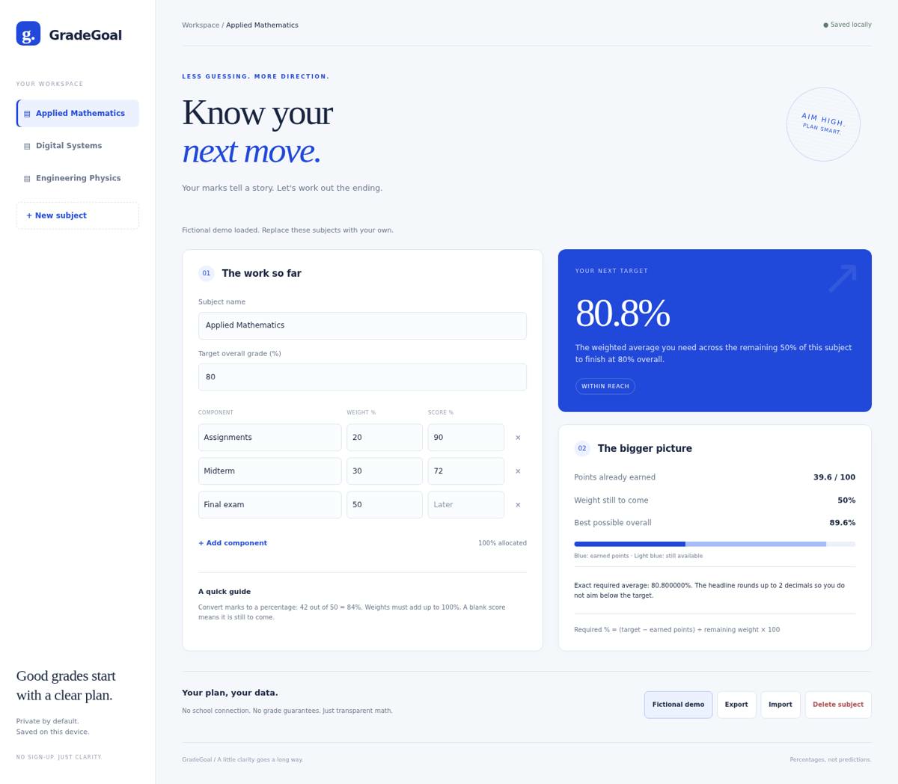
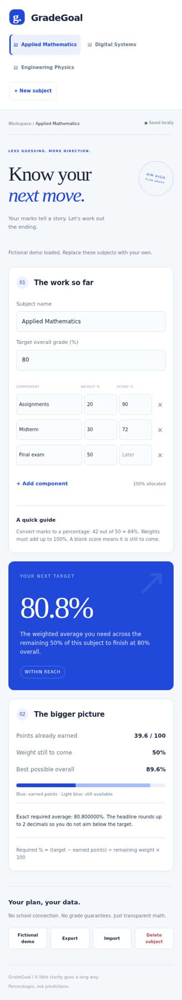

# GradeGoal

**Know your next move.** A focused, private grade planner that turns your scores so far into a clear target for what's left.

An original vanilla HTML/CSS/JavaScript web app with an editorial blue-and-paper visual identity. No build, account or backend.



## Features

- Track up to 20 subjects, each with up to 20 weighted components.
- Enter any target percentage and scores as percentages. Leave unfinished scores blank.
- Instantly see the weighted average needed across the remaining components.
- See earned points, remaining weight and the highest overall score still possible.
- Handle impossible and already-secured targets without misleading numbers.
- Save automatically to localStorage; import/export validated JSON backups.
- Responsive layout, labeled inputs, keyboard focus and reduced-motion support.

## Run locally

Open `index.html` directly, or serve it:

```sh
python3 -m http.server 8000
# Open http://localhost:8000
```

No installation or build step. `Fictional demo` loads invented subjects and scores after a replacement confirmation.

## How the calculation works

Every component has a weight and an optional score, both expressed as percentages. Weights must add up to 100. A real zero is a completed score; a blank is still to come.

```
earned points = sum(weight × score / 100) for completed components
remaining weight = sum(weight) for unfinished components
required average = (target − earned points) / remaining weight × 100
best possible overall = earned points + remaining weight
```

For example, assignments at 90% weighted 20% and a midterm at 72% weighted 30% earn 39.6 overall points. To finish at 80%, the final (50% weight) needs **80.8%**.

The required average is a *weighted* average across all remaining components, not a separate required score for each. Equal scores on each remaining component are one way to achieve it, but many other combinations can work.

The headline rounds **up** to two decimals so rounding does not send you below target. The more precise computed average is shown below. Scores are not guaranteed: your course may use discrete points, pass thresholds, moderation or a different grading scheme.

## Tests

```sh
node math.test.cjs
```

13 tests cover weighted scores, real zeros, multiple unfinished components, impossible and secured targets, completed subjects, invalid weights/scores, backup validation, and 1,000 generated target calculations. Browser checks covered the fictional example, impossible-target UI, adding subjects, reload persistence, clean console, and 320px/390px layouts without horizontal overflow.

## Privacy & limits

- Data stays in your browser. It is not synced across devices and there is no school connection.
- Export before clearing browser data or replacing subjects. JSON imports replace the workspace, after confirmation, and are limited to 1 MB.
- This tool uses percentages, not institution-specific letter-grade or GPA mappings. Set your target percentage from your own course rules.
- No accounts, external libraries, external fonts, analytics or network API calls.

## Mobile



## Source map

- `index.html`: page structure and accessible inputs
- `style.css`: responsive blue editorial theme
- `logic.js`: pure, tested grade calculation and data validation
- `app.js`: subjects, local persistence and UI
- `math.test.cjs`: Node test suite

Screenshots show the actual running app. All sample data is fictional.
